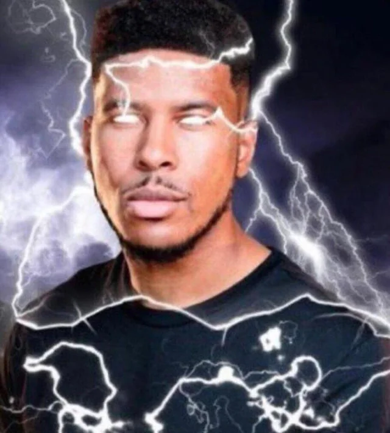

This post is part of the [player's advice bandwagon](https://www.prismaticwasteland.com/blog/blogwagon-summons-how-to-be-a-good-player) !!!!

What is a player? Someone that plays their PC? Interacts with the party, setting, and the GM? Creates collaborative stories? All of the above might be true. What's a Gamemaster? Someone that is responsible for the world? Play the NPC? Commanders the enemy in co-

You get it. There's a clear distinction in the division of roles TTRPGs. Especially on trad. But shitting on trad is boring, redundant. Rather than that, I think we can do better. Let's assume the system, the GM, the table, are good, already good, good enough for you. How do you get better then?

I'm not gonna tell you to learn improv, or take theatre lessons. It's a good complimentary skill that's for sure, but is it needed? Nah. TTRPG is a form of theatre itself anyways, you'll improve your improv skills as you play. Let's see...upgrade your communication? Let's assume you practiced that. Hmm...

Let's...stop thinking about the table. About you at the table. Let's step back. Way back. Mentally imagine yourself out of the room. There you go. You're back in your home, your laptop ready to research. In accordance with my advice, let's go through the first one.

# Stop playing.

I meant this not as a "Stop playing around", which is absurd because you're supposed to be fucking around anyways in TTRPG. I don't mean to literally stop in the middle of the session and do what I'll tell you. Whenever you have free time and you have the desire to improve yourself in your sessions, heed this advice.

Stop playing and start **engaging** with more media; read more novels, watch more movies. Don't know where to start? Ask your GM what touchstone does your campaign use and watch the media. Already familiar with it? Watch another genre; tackle media that you fear or you hate and slowly watch it.

Stop playing and start **talking** to more people. Meet outside your usual circle; connect with more people from entirely different backgrounds or cultures. Ask about their life experience; exchange stories, and take notes; Be genuinely curious, form a bond with em.
git a
You can naturally be good at roleplaying by playing many many sessions, but if your frame of reference is next to nothing, how can you be able to give life to various PCs you have? How can you appreciate the intricacies of the world your GM has brought to you? 

A lot of TTRPG blogs use cooking as an analogy so I'm gonna use that too. You can eventually cook and cook and cook until you get the recipe right. But, what if you actually watch tutorials on how to cook? Taking a bit further, what if you watch… movies just so you know what emotion to put to your cooking? The more experiences you have, the richer your roleplay will be.

## Stop being a player

It's...technically not the best title. Let me add one tiny word to give it more context.

# Stop being (just) a player

It might be tempting to sit back and play your PC when it's your turn. Spotlight management is important yes, but, that doesn't mean that's your sole function there. Both In Character and Out of Character talk, there is one simple strategy you must remember.

In order for everyone to have fun, you've got to

### Help others. Help your players. Help your GM.

You see your character and your friend's character haven't fully developed? Take an initiative and initiate some conversations, both IC and OOC. Your friend wants to talk with the local bartender but is confused? Step in and help smooth things out. As a player, you too can help alleviate the burden of the GM. You don't even need to be in the director seat, you can still help normally/canonically. Besides, even if it doesn't make sense in lore (your character usually wouldn't help others or something), just retcon it man. Being accurate to your character is important but if it meant making the story a tad bit complicated or slow, that's not worthed it man.

Another example is you went dungeon crawling and your party seemed to be ignoring the dungeon, only focusing on combat here and there. You see the GM's eyes fade away on each NPC they prepared but your fellow party just ignores past through. Be aware of the table and step in. Take initiative and start talking and taking interest in the NPCs. Cause trouble for the party if it meant making your party alerted. It's okay man.

Helping functions both to assist others and to ease their burden. Make them easier to roleplay to their character. It's not that your GM sucks that you have to step in or something. As a player, you gotta be able to jump in the director's chair once in a while (even when you’re just a player). Observe the meta state of the game. Are they dragging? Just take the bite and cause some trouble to force a scene, or nudge your quiet friend a question for them to jump into the conversation.